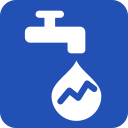
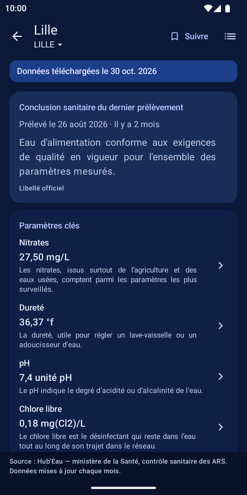
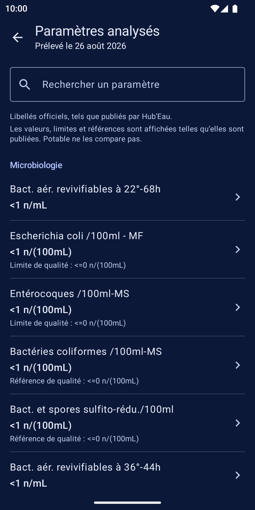
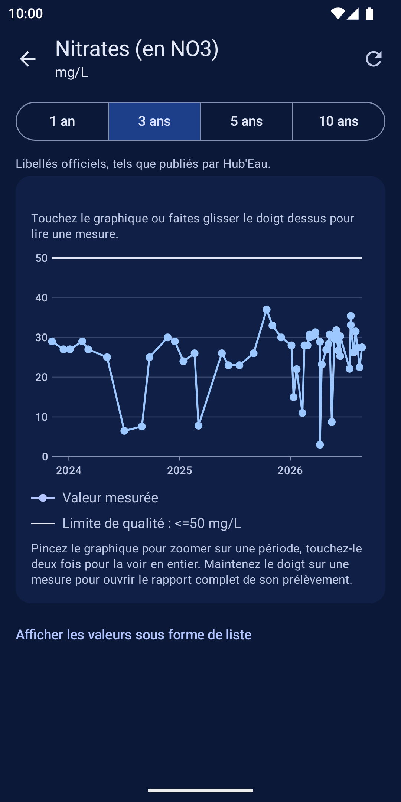

<p align="center">
  
</p>

<h1 align="center">Potable</h1>

<p align="center">
  L’eau du robinet de votre commune : les analyses officielles, sans traqueur.
</p>

<p align="center">
  <a href="https://github.com/mgdx/Potable/actions/workflows/ci.yml"></a>
  <a href="LICENSE"></a>
  
  
  
  <a href="docs/translations.md"></a>
  <a href="https://liberapay.com/mgdx"></a>
</p>

<!-- À décommenter à la publication (Potable n'est encore publié ni sur F-Droid ni sur Google Play).
<p align="center">
  <a href="https://play.google.com/store/apps/details?id=io.github.mgdx.potable"></a>
  <a href="https://f-droid.org/packages/io.github.mgdx.potable/"></a>
</p>
-->

## Description

**Potable** est une application Android qui affiche les résultats du contrôle
sanitaire de l’eau du robinet en France : la conclusion du dernier prélèvement
fait sur le réseau qui dessert votre commune, le détail de chaque paramètre
analysé, et leur évolution dans le temps.

Ces résultats sont ceux que les agences régionales de santé (ARS) établissent
et que le ministère chargé de la santé publie sur
[Hub’Eau](https://hubeau.eaufrance.fr/). Potable les **restitue tels quels** :
il n’y ajoute ni note, ni score, ni avis de son cru.

C’est un logiciel libre sous GPLv3. Il n’utilise aucun service Google, ne
demande aucun compte, et ne parle qu’à un seul serveur : celui de Hub’Eau.

## Captures d’écran

<p align="center">
  
  
  
</p>

## Fonctionnalités

- 🔎 **Trouver sa commune sans réseau.** Les 34 879 communes de métropole, de
  Corse et d’outre-mer (codes `97x`, là où les ARS exercent le contrôle
  sanitaire) sont embarquées dans l’application, avec leurs
  communes déléguées, les arrondissements de Paris, Lyon et Marseille et les
  anciens codes des communes fusionnées. La recherche par nom ou par code
  postal ne sort pas du téléphone et ignore les accents et la casse :
  « orleans » trouve Orléans.
  - **« Autour de moi »**, en option : la permission de localisation n’est
    demandée qu’au moment où vous touchez le bouton, jamais au lancement.
    La refuser ne bloque rien, la saisie reste possible.

- 🚰 **Le bon réseau, expliqué.** Une commune peut être desservie par
  plusieurs **unités de distribution** — des parties du réseau qui
  distribuent chacune une eau de même qualité, souvent un quartier. Quand il
  n’y en a qu’une, Potable la choisit sans rien demander ; quand il y en a
  plusieurs, il les liste avec leur nom de quartier, explique en une phrase ce
  qu’est une unité de distribution, et retient votre choix.

- 💧 **La fiche « mon eau ».** La conclusion sanitaire du dernier prélèvement,
  **telle que l’ARS l’a publiée**, en évidence ; la date du prélèvement et son
  ancienneté ; le distributeur et la collectivité responsable ; les
  conformités bactériologique et physico-chimique, limites et références de
  qualité distinguées ; et quelques paramètres clés expliqués en une phrase :
  dureté, nitrates, pH, chlore libre. Une conclusion défavorable est signalée
  par un texte et une icône, jamais par la seule couleur.

- 🧪 **Le détail du prélèvement.** Tous les paramètres analysés, regroupés par
  famille (bactériologie, physico-chimie, pesticides, métaux…), avec leur
  valeur, leur unité et la limite de qualité quand elle est publiée, et une
  recherche dans la liste.

- 📈 **L’historique d’un paramètre.** Sa courbe sur 1, 3, 5 ou 10 ans, avec la
  limite réglementaire tracée quand elle existe ; une valeur publiée sous un
  seuil de détection (« <0,01 ») est marquée à part, pour ne pas inventer de
  mesure. Chaque point se touche pour lire sa date et sa valeur, et la liste
  des valeurs est aussi lisible sans le graphique.

- 🗓️ **La frise des conclusions.** Les prélèvements successifs de votre unité
  de distribution et la conclusion de chacun, pour voir d’un coup d’œil si une
  non-conformité est un épisode isolé ou une habitude.

- ⭐ **Plusieurs communes suivies, consultables hors ligne.** Le domicile, une
  résidence secondaire, la famille : chaque commune suivie garde sa dernière
  analyse et son historique sur le téléphone, s’affiche en mode avion avec la
  date de ses données.

- 🔔 **Des alertes sobres.** Désactivées par défaut. Si vous les activez,
  Potable vérifie chaque semaine (ou toutes les deux ou quatre semaines) s’il
  y a une nouvelle analyse pour vos communes suivies, et vous prévient soit à
  chaque nouvelle analyse, soit seulement en cas de conclusion défavorable.
  Une requête légère par commune, aucun service au premier plan, aucun réveil
  exact, aucune exemption d’optimisation de batterie.

- 🌍 **En anglais et en français.** Les libellés officiels (paramètres,
  unités, conclusions) restent en français dans les deux langues : ce sont des
  données, pas de l’interface.

- 🌗 **Thème clair, sombre ou celui du système.**

## Ce que Potable ne fait pas

Ces limites ne sont pas des manques à combler : elles sont la condition pour
que l’application dise vrai. Elles sont rappelées au premier lancement et dans
l’écran « À propos ».

- **Aucun score, aucune note, aucun classement.** Potable n’établit aucun
  verdict propre et ne compare pas les communes entre elles. Il montre les
  conclusions des ARS, avec leurs mots.
- **Aucun avis sanitaire.** L’application ne vous dit pas si vous pouvez boire
  votre eau. En cas de doute, adressez-vous à votre ARS ou à votre
  distributeur d’eau.
- **Votre robinet n’est pas couvert.** Les prélèvements portent sur l’unité de
  distribution, pas sur l’eau qui sort chez vous : l’état des canalisations
  privées de votre immeuble ou de votre maison n’y apparaît pas.
- **Les données ont un mois de retard, au moins.** Hub’Eau est mis à jour une
  fois par mois : un résultat affiché peut avoir plusieurs semaines.

## Vie privée

- **Un seul domaine contacté** : `hubeau.eaufrance.fr`, en HTTPS. Le trafic en
  clair est interdit par la configuration réseau de l’application.
- **Votre position n’est jamais transmise ni enregistrée.** Si vous utilisez
  « Autour de moi », elle sert une fois, sur le téléphone, à trouver la
  commune la plus proche dans le référentiel embarqué, puis elle est oubliée.
- **Aucune télémétrie**, aucun rapport de plantage, aucune publicité, aucun
  identifiant.
- **Pas de compte.** Rien à créer, rien à confier.
- **Vos communes suivies restent sur le téléphone.** Potable n’a pas de
  serveur : personne d’autre que vous ne sait lesquelles vous suivez. Hub’Eau,
  lui, reçoit les codes des communes que vous consultez, comme tout site reçoit
  ce qu’on lui demande.

Le détail — ce qui est enregistré, ce que chaque requête révèle, à quoi sert
chaque permission — est dans la
[politique de confidentialité](docs/privacy-policy.md).

## Installer

Chaque version est publiée sur la
[page des versions](https://github.com/mgdx/Potable/releases/latest) de ce
dépôt : un APK signé, son empreinte SHA-256 et celle du certificat de
signature. La publication sur [F-Droid](https://f-droid.org/) est en
préparation, celle sur Google Play viendra ensuite ; Potable se compile aussi
depuis les sources.

<!-- À décommenter à la publication.
Depuis [F-Droid](https://f-droid.org/packages/io.github.mgdx.potable/), qui
recompile l'application à partir de ces sources et la met à jour avec le reste
du catalogue.

Depuis [Google Play](https://play.google.com/store/apps/details?id=io.github.mgdx.potable),
pour qui préfère le magasin habituel.

Ou depuis la [page des versions](https://github.com/mgdx/Potable/releases/latest).
-->

## Compiler depuis les sources

Il faut un **JDK 21** et le **SDK Android** (compileSdk 37). Aucune clé, aucun
compte, aucun service tiers.

```bash
git clone https://github.com/mgdx/Potable.git
cd Potable
./gradlew assembleDebug      # APK de debug
./gradlew test               # tests unitaires, sur la JVM, sans émulateur
./gradlew lint ktlintCheck   # analyse statique, aucun avertissement toléré
./gradlew check              # tout ce qui bloque une fusion, dont checkRtl
adb install -r app/build/outputs/apk/debug/app-debug.apk
```

Les tests de la base Room et des notifications tournent sous Robolectric, qui
télécharge son image Android depuis Maven Central à la première exécution.

L’intégration continue lance `./gradlew check`, les contrôles Python de
`tools/` et une build release non signée (APK sous 6 Mo) à chaque push sur
`master` et sur chaque pull request.

**Le référentiel des communes** (`data/src/main/assets/communes.tsv`) est
versionné : il n’est pas nécessaire de le régénérer pour compiler. Pour le
mettre à jour, après chaque révision annuelle du Code officiel géographique :

```bash
python3 tools/generate_communes.py   # Python 3, bibliothèque standard seulement
python3 tools/check_communes.py      # contrôle du fichier produit
```

Les sources, les choix et le format sont décrits dans
[`tools/README.md`](tools/README.md).

## Dépendances

Une poignée de bibliothèques libres — Jetpack Compose et Material 3, Room,
DataStore, WorkManager, OkHttp, kotlinx.serialization — chacune justifiée dans
[`docs/dependencies.md`](docs/dependencies.md) : ce qu’elle fait, sa licence,
et pourquoi elle plutôt qu’une autre. Aucune bibliothèque d’analyse, de
rapport de plantage ou de publicité, sous aucun prétexte. La localisation passe
par le `LocationManager` d’Android, sans Google Play Services.

## Contribuer

Les contributions sont bienvenues : voir **[CONTRIBUTING.md](CONTRIBUTING.md)**,
et ouvrir une issue avant un changement important.

- 🗣️ **Relire la traduction française.** Elle a été produite par IA et
  **attend la relecture d’un locuteur natif**. Le vocabulaire est fixé par le
  [glossaire](docs/glossary.md), et
  [`docs/translations.md`](docs/translations.md) tient l’état de relecture et
  explique comment s’y prendre. Potable n’est proposé qu’en anglais et en
  français : aucune autre langue n’est prévue.
- 🐛 **Signaler un bug**, avec l’appareil, la version d’Android, la commune
  concernée et la façon de le reproduire. Une faille de sécurité passe par
  [`SECURITY.md`](SECURITY.md), pas par une issue publique.
- 💻 **Écrire du code.** `./gradlew check` doit passer sans un seul
  avertissement, la logique métier va dans `:core`, sans import Android, et
  aucune chaîne n’est codée en dur.

Lisez d’abord [`SPEC.md`](SPEC.md) : c’est la source de vérité du projet. Pour
aller plus loin : l’[architecture](docs/architecture.md), les
[décisions](docs/decisions.md), le
[comportement observé de l’API Hub’Eau](docs/hubeau-api.md) et les
[outils](tools/README.md).

Et si rien de tout cela n’est pour vous : une ⭐ sur le dépôt aide la
prochaine personne qui cherche à savoir ce qui coule de son robinet à trouver
une application qui ne l’espionne pas.

Pour soutenir le travail lui-même, vous pouvez faire un don sur
[Liberapay](https://liberapay.com/mgdx).

<p align="center">
  <a href="https://liberapay.com/mgdx"></a>
</p>

## Sources des données et licences

- **Résultats du contrôle sanitaire** : API Hub’Eau
  [« Qualité de l’eau potable »](https://hubeau.eaufrance.fr/page/api-qualite-eau-potable),
  données du ministère chargé de la santé et des agences régionales de santé
  (ARS), utilisées selon les
  [conditions générales d’utilisation de Hub’Eau](https://hubeau.eaufrance.fr/page/conditions-generales).
- **Référentiel des communes** : Découpage administratif communal,
  [geo.api.gouv.fr](https://geo.api.gouv.fr), et Code officiel géographique
  de l’INSEE (dont le fichier des mouvements de communes), sous
  [Licence Ouverte Etalab 2.0](https://www.etalab.gouv.fr/licence-ouverte-open-licence/).
- **Pertinence des métabolites de pesticides** : Anses,
  [« Tableau relatif aux métabolites pertinents pour les EDCH »](https://www.anses.fr/fr/content/tableau-metabolites-pesticides-edch),
  mise à jour de juillet 2025, informations publiques réutilisées en citant
  l’Anses et la date de mise à jour (voir `docs/dependencies.md`).

Ces mentions figurent aussi dans l’écran « À propos » de l’application.

## Pourquoi « Potable »

Le mot s’écrit et se lit de la même façon en français et en anglais : il dit
de quoi parle l’application dans les deux langues de son public le plus
probable, et n’a pas besoin d’être traduit dans les six autres.

Et c’est un adjectif qui décrit l’eau qu’on contrôle, pas une promesse. Une
eau *potable* est celle que le contrôle sanitaire vise à garantir ; c’est à
l’ARS de dire si elle l’est, prélèvement après prélèvement. L’application
porte le nom de la question, elle ne prétend pas y répondre à sa place.

## Licence

[GPLv3](LICENSE), version 3 uniquement (`GPL-3.0-only`). Les données
affichées restent sous leurs licences propres, rappelées ci-dessus.
